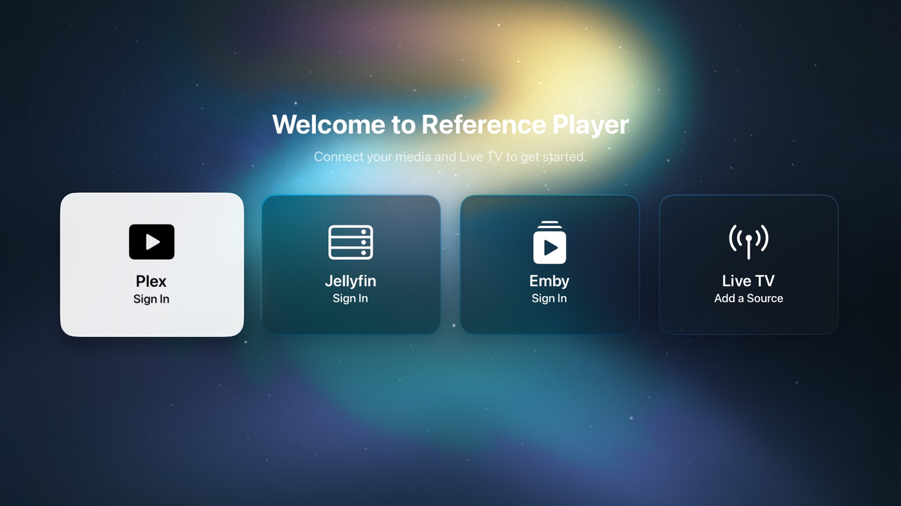
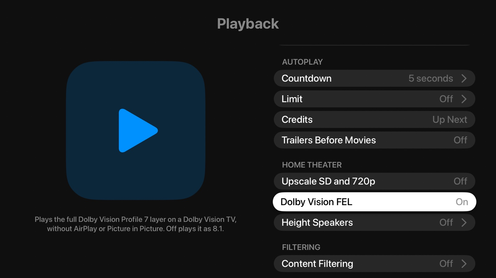

# Reference Video Player

Reference Video Player is a noncommercial Apple TV app for Plex, Jellyfin, Emby and IPTV.
It is an independent fork of [Rivulet](https://github.com/l984-451/Rivulet) by Bain Gurley.
Put questions about Reference Video Player in this repository.

## TestFlight

[Join the Apple TV beta on TestFlight](https://testflight.apple.com/join/d18PdcjP). The beta
requires tvOS 26 or later. The invitation opens after Apple approves the beta.



## The idea

The name states the aim: a reference player plays what is in the file. This fork tries to keep a
source's picture and sound as intact as tvOS permits. When there is a choice, it uses the path that
changes the least.

In the app, that aim has these results:

- On a Dolby Vision TV, the app asks the engine to compose the enhancement layer of a Profile 7 FEL
  title. It does not ask the engine to drop that layer.
- When your server offers a file directly, the app plays the original file.
- The app uses a server transcode only in these cases:
  - There is no usable direct link.
  - You pick a lower quality.
  - The player fails to start.
- With Height Speakers set, an object soundtrack keeps its height channels. The app sends the sound
  as lossless PCM over HDMI.
- Format badges tell you what a file is.
- The app does not contact upstream's hosted services.
- Where Apple's platform forces a conversion, the app must say so plainly. It must never label the
  result as more than it is.

The limits are just as plain:

- Apple TV cannot pass the original audio bitstream to a receiver. As a result, the receiver does
  not decode the sound with its own decoder.
- No test has shown that the rendered channels match a receiver's decoding.
- On a physical Apple TV, this fork's author has only timed the FEL route so far
  ([FEL on real hardware](#fel-on-real-hardware)). The author has not checked the picture or the
  sound there.

This is a goal for the fork. It is not a claim that the fork has reached the goal.

## What it adds

The settings below are available on Apple TV.



### Dolby Vision Profile 7 FEL

A Profile 7 title can have a full enhancement layer (FEL). For such a title, the playback engine can
decode the base layer and the enhancement layer and compose them itself. This is the engine's
dual-layer route. Without this route, the player drops the enhancement layer. Settings > Playback >
Dolby Vision FEL controls the route. The default is On.

Limits:

- The app asks for the route only when the TV reports Dolby Vision support. Only FEL sources take
  the route. Without a Dolby Vision TV, Profile 7 plays its HDR10 base layer.
- The engine converts Profile 7 MEL titles to single-layer Profile 8.1. It does the same for FEL
  titles that do not take the route.
- In that conversion of a FEL title, the engine folds the enhancement layer's average effect on
  brightness into each scene's luma curve. It does this where it can measure the effect. The
  conversion keeps the overall tone. It does not keep the fine detail and the grain.
- The engine refuses the route when a title is over its real-time budget. The budget is UHD at
  30 fps plus a 1080p enhancement layer. The engine then plays the 8.1 conversion.
- The route is a software path. An AirPlay receiver gets the sound but no picture.
- The composed picture leaves the engine as 10-bit video. This is not a promise of 12-bit output to
  the TV.
- A Dolby Vision indicator on the TV does not prove that every frame used the enhancement layer. The
  engine sends a frame as its base layer when that frame's enhancement layer arrives late or
  composition fails.
- The player's Details tab shows which of these happened, from the engine's report: Dual Layer
  (FEL), Profile 8.1 (converted) or HDR10 Base Layer.
- The route is demanding on older Apple TV hardware. Simulator builds and Debug builds give no data
  about it. [FEL on real hardware](#fel-on-real-hardware) has timings from two Apple TVs.
- This fork's author has not yet checked that the TV shows the composed picture correctly.

### Height speakers for TrueHD Atmos and DTS:X

Settings > Playback > Height Speakers selects a layout: 5.1.2, 5.1.4, 7.1.2, 7.1.4 or 9.1.6. With a
layout set, an object soundtrack keeps its height channels. The playback engine renders them into
that layout, and the app sends lossless PCM over HDMI. The default is Off.

Limits:

- You need tvOS 26 or later and a 48 kHz track: TrueHD, or DTS-HD Master Audio for DTS:X.
- DTS:X heights render only into 7.1.4 or 9.1.6. With a smaller layout, a DTS:X track plays its
  ordinary channels.
- The app sends fixed channels. It does not send the original bitstream or movable objects. As a
  result, your receiver does not use its own Atmos or DTS:X decoder.
- No test has shown that the rendering matches a receiver's.
- HDMI is the target. AirPlay is a different, lossy path.
- An Atmos or PCM indicator on a receiver does not prove that the heights arrived correctly.
- The feature can be demanding on older Apple TV hardware. Simulator builds and Debug builds give no
  data about playback performance.

### Other additions

- **Format badges** on detail pages and folder lists: DV FEL, DV MEL and TrueHD Atmos. The app reads
  them from an optional index of your own library (Settings > Playback > Format Tags). The tools
  that build the index are in `PrivateBuild/tools/format-index/`. The default is no index address,
  and then the app fetches nothing.
- **Playback reports to Home Assistant.** This is optional and off by default. The app has no
  built-in address. A package and a dashboard card are in `PrivateBuild/homeassistant/`.
- **Discover, recommendations, actor biographies, and Metacritic and Letterboxd scores** from your
  own free TMDB and MDBList keys (Settings > Playback > Discover and Scores). Without keys, the app
  fetches nothing from those services.
- **No upstream hosted services.** Rivulet's author runs these services for his app: the metadata
  Workers, in-player trivia, the Live TV sports scoreboard and diagnostics upload. This fork does
  not use them. Those screens are still there, but the app refuses each request to upstream's
  services before the request goes on the network. With your own keys, Discover and scores come from
  TMDB and MDBList (above). The app has no built-in Sentry destination.
- **Tools to follow upstream releases.** `PrivateBuild/sync.py` merges an upstream release tag and
  does the mechanical part. `PrivateBuild/check.py` runs every check.

## FEL on real hardware

This is a rough benchmark from two Apple TVs. It is not a lab measurement. On 2026-11-12 and
2026-11-13, each Apple TV played the same UHD Blu-ray remux through the dual-layer route. The remux
is 3840x2160 at 23.976 fps, Dolby Vision Profile 7 FEL. The builds were Release builds on
AetherEngine 7.61.0.

The engine composes each frame from the two decoded layers on the GPU. It logs the GPU time as an
average for each window of 120 frames. `PrivateBuild/felbench.py` reads those lines and gives a
summary.

| | Apple TV 4K (2nd generation) | Apple TV 4K (4th generation) |
| --- | --- | --- |
| Model and system | AppleTV11,1, tvOS 27.2 | AppleTV18,1, tvOS 27.0 |
| GPU time per composed frame, median | 13.1 ms | 6.5 ms |
| Fastest and slowest window | 12.5 and 18.7 ms | 5.3 and 10.9 ms |
| Median as a share of the 41.7 ms each frame lasts | 31% | 16% |
| Windows timed | 23 (2,760 frames) | 16 (1,920 frames) |
| Frames composed, at the engine's last count | 2,569 | 1,785 |
| Frames sent as base layer only | 0 | 0 |
| Frames lost before the display layer, or dropped by it | 0 | 0 |
| Rebuffering | none | none |

What the table shows, and what it does not show:

- The newer Apple TV composed a frame in half the time: 6.5 ms against 13.1 ms.
- The number is the GPU step only. It does not include the decode of the two HEVC layers.
- The runs are not matched. The 2nd-generation run played the first 1 minute 56 seconds without a
  stop. The 4th-generation run started at the beginning and skipped forward five times by 30
  seconds. It ended 3 minutes 47 seconds into the film. The engine skipped 6 late frames near those
  skips.
- The two app builds were different, on the same engine version.
- One film is not the worst case. A second FEL title on the 2nd-generation Apple TV had a median of
  15.8 ms over 4 windows. Its display layer dropped 3 of 553 frames.
- Neither run checked the picture on the TV. The table gives composition times. It does not show
  that the TV displayed Dolby Vision.

To measure your own Apple TV:

1. Make sure that the Apple TV is awake.
2. Start your build with the first command below. It enables the engine's debug lines.
3. Play a Profile 7 FEL title from the beginning for two minutes. Do not skip.
4. Quit the app.
5. Run the second command to get the summary of the log.

```bash
xcrun devicectl device process launch --device "<your Apple TV's name>" --console --terminate-existing \
  --environment-variables '{"OS_ACTIVITY_DT_MODE":"YES","OS_ACTIVITY_MODE":"debug"}' \
  com.yourname.referenceplayer > fel.log
python3 PrivateBuild/felbench.py fel.log
```

Use one film for each log. Without a Dolby Vision TV, the app does not ask for the route. The script
then reports that the log has no FEL timing.

## Status

- The fork builds, and its unit tests pass on the tvOS simulator. The run of 2026-11-13 passed 3,536
  of 3,536 tvOS unit tests and 169 Python tests for the fork's tools.
- That run used Xcode 27.1, the version on the machine. Upstream pins Xcode 27.2 in
  `codemagic.yaml`.
- The checks also built the tvOS app in Release for a real Apple TV. They compiled the iOS and Mac
  apps in their default configuration.
- On a physical Apple TV, the author ran and timed the FEL route on two models
  ([FEL on real hardware](#fel-on-real-hardware)). The author has not yet checked the picture on the
  TV, the height speakers or the other playback features there.
- To build from source, sign the app with your own Apple developer account.

## Build

You need a Mac with Xcode and an Apple developer account. Upstream builds with Xcode 27.2, and
`PrivateBuild/build-tvos.sh` refuses an older version. This fork's own checks above ran on 27.1. The
apps use an App Group and an iCloud container, and these need a paid membership. This fork does not
promise that a free Personal Team can sign them.

```bash
# Secrets.swift with an empty Sentry DSN (this fork ships no Sentry destination; verify.py insists)
sed 's/"YOUR_SENTRY_DSN_HERE"/""/' RivuletCore/Config/Secrets.swift.template > RivuletCore/Config/Secrets.swift
python3 PrivateBuild/configure.py --bundle-id com.yourname.referenceplayer --team-id YOURTEAMID
python3 PrivateBuild/check.py --quick
open Rivulet.xcodeproj    # scheme: Reference Player
```

`configure.py` writes these values into the project:

- your bundle prefix
- your App Group (`group.<bundle-id>` unless you pass `--app-group`)
- your iCloud container
- your team

It can also set `--display-name` and `--url-scheme`. Register the App Group and the iCloud container
for your team in Xcode or in the developer portal.

Before you commit a change, run `python3 PrivateBuild/configure.py --placeholder`. This command
restores the placeholder identifiers of the repository. `python3 PrivateBuild/check.py --all` runs
every check. This includes the full tvOS test suite and the iOS and Mac builds.

Your build can fill in your format index URL and your Home Assistant address, so that you do not
type them with the remote:

1. Copy `PrivateBuild/PersonalDefaults.example.plist` to `Rivulet/PersonalDefaults.plist`. Git
   ignores this file.
2. Fill in your values.

On its first launch, the Apple TV app writes those values into Settings and enables the integration.

CAUTION: Do not share a build that has this file. The file and your addresses ship inside the app
that you build.

## Where things are

- The root `README.md` and the issue templates describe Reference Player.
- The user-facing app text and the built app names use Reference Player.
- The tvOS artwork uses the fork's Reference R mark.
- These keep upstream's names, to keep merges manageable: the body of `CLAUDE.md`, historical
  `Docs/`, source folders and Swift type names.
- Stored-data keys and protocol identifiers also keep their existing spelling.
- Upstream release history and legal credits have explicit attribution.
- Funding links in `.github/` still support Rivulet's original author.
- Notes for this fork are in `PrivateBuild/`. Start with `PrivateBuild/CLAUDE-private.md` and
  `PrivateBuild/SYNC.md`.

## License and credits

Rivulet and this fork are licensed under the [PolyForm Noncommercial License 1.0.0](../LICENSE).

Required Notice: Copyright (C) 2025-2026 Bain Gurley

This fork is free of charge and not for sale.

Playback and subtitles run on these components. Each keeps its own license.

- [AetherEngine](https://github.com/superuser404notfound/AetherEngine) (LGPL-3.0 with an Apple
  Store / DRM exception)
- [FFmpegBuild](https://github.com/superuser404notfound/FFmpegBuild) (FFmpeg, LGPL-2.1-or-later)
- [LibDovi](https://github.com/superuser404notfound/LibDovi) (libdovi from
  [dovi_tool](https://github.com/quietvoid/dovi_tool), dual-licensed MIT or Apache-2.0)
- [LibTrueHD](https://github.com/superuser404notfound/LibTrueHD) (MIT, with
  [truehdd](https://github.com/truehdd/truehdd) under Apache-2.0)
- [LibassBuild](https://github.com/l984-451/LibassBuild) (libass, ISC), for subtitles

Some optional components may be subject to third-party patent licensing. Whoever builds and uses
them is responsible for their own licensing.

Dolby, Dolby Atmos, Dolby TrueHD and Dolby Vision are trademarks of Dolby Laboratories. DTS:X is a
trademark of DTS, Inc. Plex, Jellyfin and Emby are the trademarks of their respective owners. This
fork is not affiliated with or endorsed by any of them.
